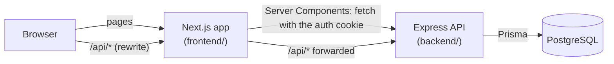
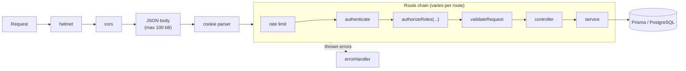
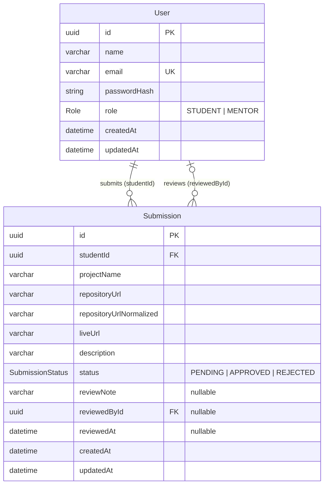
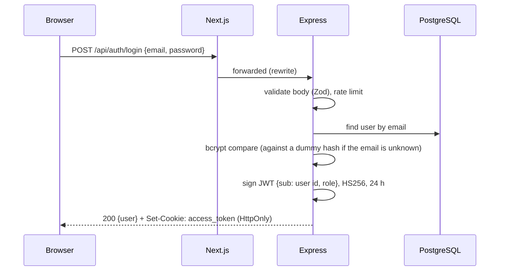

# Architecture

## Overview



Two independent npm projects live in one repository:

| | `frontend/` | `backend/` |
| --- | --- | --- |
| Role | UI: pages, forms, route guards for user experience | All business rules, validation, authentication and authorization |
| Stack | Next.js 16 (App Router), React 19, Tailwind CSS, shadcn/ui, React Hook Form, Zod | Express 5, Zod, Prisma 7, PostgreSQL, JSON Web Tokens, bcrypt |
| Talks to | The backend only, over HTTP | PostgreSQL only |

The frontend never touches the database and never decodes the token. The backend is the single authority for who the user is and what they may do.

**One origin for the browser.** `next.config.ts` rewrites `/api/*` to the Express server. The browser therefore sends every request to the Next.js origin, the auth cookie is first-party (`SameSite=Lax`), and no cross-site cookie or CORS setup is needed in the browser. Server Components call Express directly and forward only the `access_token` cookie.

## Backend

### Modules

Code is grouped by feature. Each module has the same layers:

```text
backend/src/
├── modules/
│   ├── auth/          signup, login, logout, current user
│   ├── submissions/   create, list own, read one; GitHub URL normalization
│   └── mentor/        list all, statistics, review
├── middlewares/       authenticate, authorizeRoles, validateRequest, rate limits, notFound, errorHandler
├── config/            validated environment, CORS, cookie options
├── lib/               Prisma client, JWT, password hashing, Prisma error helpers
├── utils/             response helpers, AppError, pagination
├── app.ts             builds the Express app (used by server.ts and the tests)
└── server.ts          starts the HTTP server and shuts down cleanly
```

| Layer | File | Responsibility |
| --- | --- | --- |
| Routes | `*.routes.ts` | URL, HTTP method and the middleware chain. |
| Validation | `*.validation.ts` | Zod schemas for body, query and path parameters. |
| Controller | `*.controller.ts` | Reads the validated request and the authenticated user, calls the service, sends the response. No business logic. |
| Service | `*.service.ts` | Business rules and database access through Prisma. Throws `AppError` with an HTTP status and a stable code. |
| Types | `*.types.ts` | Input types and the Prisma `select` objects that decide which fields may leave the API. |

There is no repository layer: Prisma already is the data-access layer, and an extra wrapper would add code without a benefit at this size.

### Request pipeline



- Express 5 forwards errors thrown in handlers (sync or async) to `errorHandler`, so there is no `asyncHandler` wrapper.
- `errorHandler` turns `AppError`, Zod errors, known Prisma errors and body-parser errors into the JSON error format. Anything else becomes a generic `500`, and the details are only logged.
- Unknown routes get a JSON `404 ROUTE_NOT_FOUND`, never an HTML page.
- The environment is validated with Zod at startup; the server refuses to start with a missing database URL or a short `JWT_SECRET`.

## Database



- **Two relations between the same tables.** A user has many submissions as a student (`studentId`) and many as a reviewer (`reviewedById`). Prisma names them `StudentSubmissions` and `ReviewerSubmissions`.
- **Duplicate prevention** is a unique constraint on `(studentId, repositoryUrlNormalized)`. `repositoryUrlNormalized` is the lowercase canonical URL and is never returned by the API. Because the database enforces it, two simultaneous submissions of the same repository cannot both succeed; the second one becomes a `409`.
- **Indexes:** `(status, createdAt)` serves the mentor list and filter; `(studentId, createdAt)` serves "my submissions".
- **Deletes:** deleting a student deletes their submissions; deleting a mentor keeps the submissions and sets `reviewedById` to `null`.
- **Column limits** match the validation limits, so the database rejects anything the validation might miss.
- **Migrations** live in `backend/prisma/migrations/`. The app uses Neon's pooled connection; migrations use the direct connection (`prisma.config.ts`).

## Authentication and authorization

### Logging in



Signup works the same way but always creates a `STUDENT`; the role is never read from the request.

### Every protected request

1. **`authenticate`** reads the `access_token` cookie and verifies the signature, the algorithm (only HS256 is accepted) and the expiry, then checks the payload shape (`sub` is a UUID, `role` is a known role). On success it sets `req.user = { id, role }`. Missing, invalid and expired tokens are `401` with different codes.
2. **`authorizeRoles(...)`** compares `req.user.role` with the roles allowed on the route. A logged-in user with the wrong role gets `403`.
3. **Resource checks in the service.** For example, a student's `GET /submissions/:id` query includes `studentId = req.user.id`, so another student's submission is simply not found (`404`). A review only updates a row whose status is still `PENDING`.

Authentication answers "who are you?" (`401` if unknown); authorization answers "may you do this?" (`403` if not).

**Why the role is in the token.** Checking the role needs no database query, so authorization is cheap on every request. The trade-off: if a user's role changed, the API would keep using the old role until the token expires (at most 24 hours) or the user logs in again. Roles never change in this application (mentors are only created by the seed script), so this is acceptable. `GET /auth/me` always reads the user from the database, and the database is re-checked wherever it matters, for example a review by a deleted mentor fails with `401`.

**Logout** clears the cookie. Tokens are not stored on the server, so they cannot be revoked; a copied token stays valid until it expires.

### Frontend route protection (user experience only)

| Layer | What it does | Security role |
| --- | --- | --- |
| `proxy.ts` | Redirects `/student/*` and `/mentor/*` to `/login` if there is no cookie at all. | None. It does not check the token. |
| `requireRole()` in the layouts and pages | Calls `GET /api/auth/me`. No user: redirect to `/login`. Wrong role: redirect to the user's own dashboard. | None. It only decides what to render. |
| Express middleware and services | Verifies every API request. | **This is the security boundary.** A student calling a mentor endpoint directly (Postman, curl) gets `403`. |

## Frontend

### Routes

| Route | Access | Purpose |
| --- | --- | --- |
| `/` | Public | Landing page with links to log in and sign up. |
| `/login`, `/signup` | Public | Auth forms (route group `(auth)`). |
| `/student/dashboard?page=` | Student | Own submissions with status badges, paginated. |
| `/student/submissions/new` | Student | Submission form. |
| `/student/submissions/[id]` | Student | One own submission, including the mentor's review. |
| `/mentor/dashboard?status=&page=` | Mentor | Statistics, status filter and paginated table. |
| `/mentor/submissions/[id]?status=&page=` | Mentor | Submission details with Approve / Reject. |

### Server and client components

- **Pages are Server Components.** They fetch data on the server (`features/*/server.ts`, using `lib/api/server.ts`) with the user's cookie, so no data-fetching code or token handling runs in the browser.
- **Client Components only where there is interaction:** the login, signup and submission forms, the review actions and confirmation dialog, and the logout button. They call the API through `lib/api/client.ts`, which normalizes every failure into an `ApiError` (status, code, message, field details).
- **The URL is the state** for the mentor's filter and page, so views can be shared, reloaded and navigated with the back button. There is no global client state store.
- **After a mutation** (submission, review) the client calls `router.refresh()`, so the server re-fetches the data and the statistics; nothing is updated by hand on the client.
- **Cache Components** are enabled. Pages that read the session set `export const instant = false` and stream their data inside `<Suspense>` boundaries with skeletons. Next.js keeps up to three visited pages alive but hidden (React `<Activity>`); forms that were submitted successfully reset when they are hidden, and logout reloads the page to discard everything.

### Shared building blocks

| Folder | Contents |
| --- | --- |
| `components/ui/` | shadcn/ui primitives. |
| `components/shared/` | `PageContainer`, `PageHeader`, `LoadingState`, `ErrorState`, `EmptyState`, `StatusBadge`, `ConfirmDialog`, `FormField`, `FormError`, `SubmitButton`, `PaginationControls`, `ExternalLink`, `AppHeader`. |
| `features/<feature>/` | Feature components and server-side data functions (`auth`, `submissions`, `mentor`). |
| `lib/validations/` | Zod schemas mirroring the backend rules for instant feedback. The backend stays the authority. |
| `lib/forms.ts` | Maps API field errors onto form fields. |

### Loading, error, empty and not-found states

- `loading.tsx` and `<Suspense>` skeletons for every page that waits for data; buttons show a pending label and are disabled while a request runs.
- `error.tsx` boundaries per area with a "Try again" button.
- Empty states for no submissions, an empty filter result and a page past the end.
- `not-found.tsx` for unknown routes and for submissions that do not exist or belong to someone else.

## Workflows

### Student submission

1. The form validates the input with the shared Zod rules and shows field errors.
2. `POST /api/submissions` → `authenticate` → `authorizeRoles(STUDENT)` → rate limit (per student) → `validateRequest`, which also turns the repository URL into its canonical form.
3. The service inserts the row with `studentId` from the token and status `PENDING`. A unique-constraint violation becomes `409 DUPLICATE_SUBMISSION` with a field error.
4. The form shows the error on the field and keeps the input, or shows a success toast and navigates to the dashboard, which is re-fetched.

### Mentor review

1. The mentor opens a submission from the (optionally filtered) dashboard, optionally writes a note and chooses Approve or Reject.
2. A confirmation dialog names the project and states that reviews are final.
3. `PATCH /api/mentor/submissions/:id/status` → `authenticate` → `authorizeRoles(MENTOR)` → `validateRequest` (UUID id; status `APPROVED`/`REJECTED`; note ≤ 500 characters).
4. The service runs a single `UPDATE … WHERE id = :id AND status = 'PENDING'`, setting the status, note, `reviewedById` (from the token) and `reviewedAt` (server time).
5. It then reads the submission: missing → `404`; the update changed nothing → `409 SUBMISSION_ALREADY_REVIEWED`; otherwise `200` with the updated submission.
6. The page refreshes. After a `401`, `404` or `409` it also refreshes, so the mentor sees the real state instead of a stale form.

Because the status check is part of the `UPDATE`, PostgreSQL guarantees that of two simultaneous reviews exactly one succeeds.
